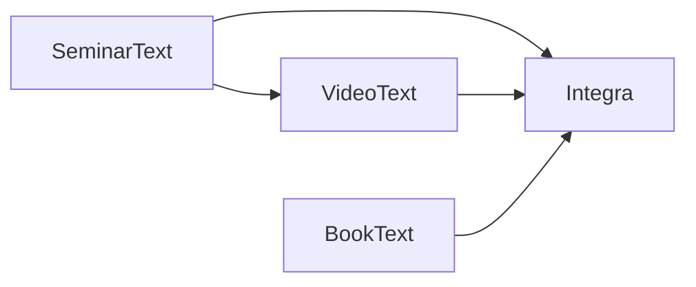

# Authoritative activated releases and vertical integration

## Authority and foundation scope

Owner authorization: **Four-Product Architecture — Central Repository Foundation**,
2026-10-27. The Owner explicitly authorized the private repository
`Yurielo/four-product-architecture`, default branch `main`, its minimal registry,
history, publication, validation, tests and documentation. Product-repository
integration and product deployment are excluded from this foundation.

Canonical unified rules were resolved and read before execution:

- Repository/path: `Yurielo/integra`, `docs/governance/UNIFIED_CODEX_RULES.md`.
- Main commit: `86e0801963e85e8d8b121c569fe624bb64ede5df`.
- SHA-256: `8b8e31c7620d45e1e14429e07e7b97b2adc118745ce781a55b932213c55b646b`.
- [Exact source](https://github.com/Yurielo/integra/blob/86e0801963e85e8d8b121c569fe624bb64ede5df/docs/governance/UNIFIED_CODEX_RULES.md).

Baseline: the completed **Four-Product Architecture — Final Audit and
Implementation Readiness**, 2026-10-27, and its directly verified native source
and installation evidence. The initial records retain actual native receipts
and fresh bounded artifact observations; this document does not create another
current-version register.

Binding Owner decisions:

1. This repository is the single central authority for current activated product releases.
2. Successful native Deployment/Activation precedes eligibility for registration.
3. Each of the four products retains its independent lifecycle, QA, release gates and Owner Acceptance.
4. Dependency updates introduce no additional product QA or Owner Acceptance process.
5. Integration proceeds from providers to their actual consumers.
6. Exact artifact identities, actual dependencies, reproducibility and historical provenance are preserved.
7. No separate server, database, runtime service or second authoritative registry is introduced.

## Verified graph and ownership

SeminarText owns transcription/timing/evidence and Knowledge admission;
VideoText owns media/subtitles and its native workflows; BookText owns document
processing/OCR and exports; Integra owns orchestration and governed integration.
There is no SeminarText-to-BookText edge and no reverse runtime dependency on
this repository. Native apps work offline with their selected components.

| Provider → consumer | Mechanism and source evidence | Update consequence |
|---|---|---|
| SeminarText → VideoText | Bundled `Resources/SeminarText`, subprocess execution; bundled executable preferred. [Build](https://github.com/Yurielo/videotext/blob/814c2aeab4eb76cd345c484575507ac73da11784/scripts/build_app.sh), [locator](https://github.com/Yurielo/videotext/blob/814c2aeab4eb76cd345c484575507ac73da11784/Sources/videotext/Services/SelectedTimingVerticalSlice.swift#L495). | Changed component requires a new packaged/signed consumer release through the normal lifecycle. Updating standalone SeminarText is insufficient. |
| SeminarText → Integra | Bundled CLI/modules/schemas and review components; optional external checkout must match exact pin/hashes. [Runtime](https://github.com/Yurielo/integra/blob/86e0801963e85e8d8b121c569fe624bb64ede5df/integra_core/seminartext_runtime.py#L14), [review packaging](https://github.com/Yurielo/integra/blob/86e0801963e85e8d8b121c569fe624bb64ede5df/scripts/package_review_runtime.py). | Update coordinated component identities and repackage a new Integra Candidate. |
| VideoText → Integra | Compiled worker from pinned VideoText sources, not invocation of standalone VideoText.app. [Worker build](https://github.com/Yurielo/integra/blob/86e0801963e85e8d8b121c569fe624bb64ede5df/scripts/build_videotext_worker.sh#L5). | Recompile when the consumed source closure changes; new Integra Candidate. A VideoText UI-only change need not affect that closure. |
| BookText → Integra | Bundled pinned Python entrypoint plus compiled Vision OCR; external OCR tools/models remain native runtime prerequisites. [Build](https://github.com/Yurielo/integra/blob/86e0801963e85e8d8b121c569fe624bb64ede5df/scripts/build_macos_app.sh#L69), [runtime](https://github.com/Yurielo/integra/blob/86e0801963e85e8d8b121c569fe624bb64ede5df/integra_core/booktext_runtime.py#L71). | Replace changed packaged source; compile changed Vision source; new Integra Candidate. Standalone BookText Core installation does not update this copy. |

BookText GUI executes its own external Core through
[`CoreConfiguration`](https://github.com/Yurielo/booktext/blob/b8781d7dd9364d96958f4e93d4ad4679bac21dc0/BookTextApp/Sources/BookTextCore/MachineProtocol.swift#L94).
Its registered release is a composite of app and configured Core identities.
This is not an edge between two of the four products. External Python, FFmpeg,
Ollama, OCR tools and model files are platform prerequisites, not invented
product-version authorities. Their native manifests remain authoritative for
their own configuration; this foundation does not change them.

No consumer rebuild is justified solely by provider documentation changes.
Equivalence must cover the actual consumed files and contracts. Preserve the
old consumer pin even if those bytes equal a newer provider's component.

## Initial registration and explicit gaps

`registry.json` is the only current register. `history` contains two historical
successful native activations adopted during foundation creation. Their exact
activation times are unknown (`activated_at: null`); `recorded_at` is the time
of preparing the central record, not a claimed deployment time. Evidence files
retain original comment dates/bodies/URLs and fresh observations.

- VideoText: native exact-Candidate delivery completion and Owner PASS are
  retained in `evidence/videotext-initial-activation.json`. Its entire installed
  bundle digest was rechecked with the native release-gate file-list algorithm;
  the actual embedded SeminarText remains
  `cf7a8445fa9f9dffc62b7ae24062e80475a3d223`.
- BookText: native installed Core/signature/LaunchServices completion is
  retained in `evidence/booktext-initial-activation.json`. The app bundle hash,
  clean installed Core commit/tree and configured Core path were directly
  checked. GUI source commit is unknown; it is not inferred from Core.
- SeminarText: installed 4.0.0 and 24/24 component equality were established in
  the audit. The deploy backup manifest is written before completion. A complete
  final native post-deploy success receipt is not established: **unregistered**.
- Integra: accepted K1 CURRENT Candidate
  `675acf457d65e7633481bcea700036b7e9ef6298e0c6d6eb097e513d3bff249f`, bundle
  `e3215a28c9ce0a1a54c35dc535bad42a9334cae7ddc5eb3b0533a480e0296d95`, is not proven
  activated. Its manifest source is `a9567d64fc3345d16b16dd0fbf5953680fb884d4`;
  the baseline main reference `312946d42c9712e4ee3b7974fe657762e8092c1d` is a
  different identity. The observed READY_APP contains SeminarText
  `a94936cd77cde13561c97c804ece1ac1134e01a6`, VideoText
  `2e098d1705b6815628bee1e023f4742718eabf02`, and BookText
  `46396649214275eb18054b670a842bace02d02e1`; these are audit observations,
  **not current centrally registered product releases**. Integra remains unregistered.

## Native completion events reused

| Product | Existing activation completion boundary |
|---|---|
| SeminarText | Governed deploy plus inventory/hash verification, functional smoke, required tests/Integrity and exact source/runtime identity. [Workflow](https://github.com/Yurielo/seminartext/blob/48cabde2ddd7918480b4a6bb05ed39f774665c20/DEVELOPMENT_WORKFLOW.md#L221). |
| VideoText | Exact Owner PASS → final verification → merge → exact Candidate installation → post-install smoke → DELIVERED. [Release gate](https://github.com/Yurielo/videotext/blob/814c2aeab4eb76cd345c484575507ac73da11784/docs/RELEASE_GATE.md#L83). |
| BookText | Existing accepted native release and authorized installation, binding app/Core identities, signature and normal launch. [Completed installation](https://github.com/Yurielo/booktext/issues/116#issuecomment-5968962731). |
| Integra | Applicable native Candidate/Proposal/Owner authority plus actual authorized activation of the exact accepted bytes. [Promotion helper explicitly does not deploy](https://github.com/Yurielo/integra/blob/86e0801963e85e8d8b121c569fe624bb64ede5df/docs/PROPOSED_BASELINE_LITE_IMPLEMENTATION.md#L22). |

Registry validation serializes these completed native facts. It does not grant
Owner acceptance, rerun product QA or waive any native gate.

## Remaining integration order

1. Next dependency-ready product task, under its applicable authorization:
   connect SeminarText's native post-deploy completion evidence to this receipt
   format, using `scripts/seminartext-dev`, `integrity/integrity_contract.json`
   and the existing runtime-truth checks. Recover valid existing success
   evidence first; do not run a new deploy solely to fill an evidence gap.
2. Independently connect BookText's existing install completion to the same
   publisher, preserving its configured app/Core pair.
3. Resolve a registered SeminarText identity during VideoText preparation;
   freeze it into the existing bundle/manifest and publish VideoText only after
   its ordinary DELIVERED boundary.
4. Resolve the actual ST/VT/BT component inputs for Integra; update coordinated
   packaging/runtime validators only for changed dependencies; combine ready
   inputs into a necessary native Candidate build. Preserve CURRENT, protection,
   archives, semantic authority and Owner boundaries. Activation still needs
   separate applicable native authority.

Product adapters are not implemented here. No automatic propagation, model
migration, product build, install or deployment is part of this foundation.
